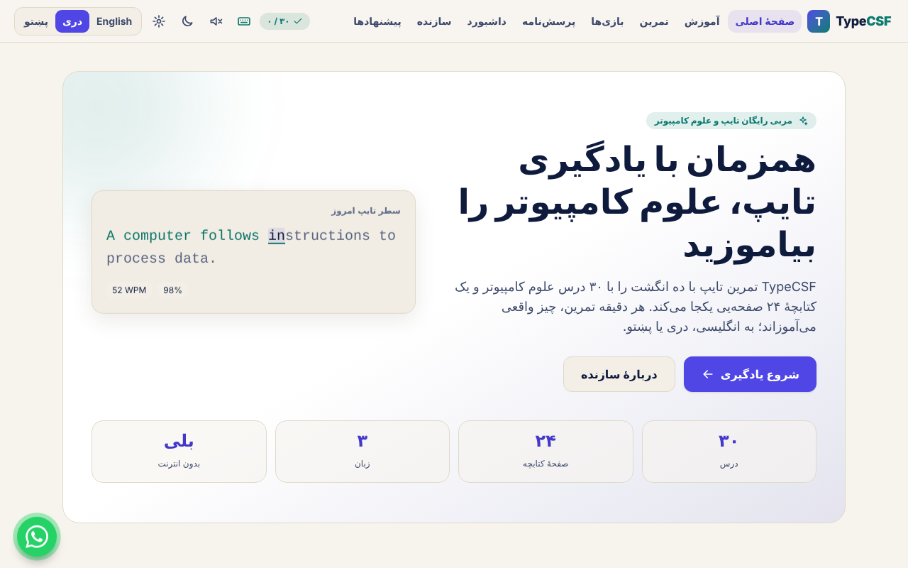

# TypeCSF 3.0 — learn Computer Science while you learn to type

A free typing trainer that teaches Computer Science. Built with **React 19 + Tailwind CSS v4 + Vite**, in **English, Dari (دری) and Pashto (پښتو)**, with full right-to-left support and an installable offline PWA.

Created by **Wahidullah Hussaini**, student at Kabul Education University.



## What is inside

| Area | Details |
|---|---|
| Learning | 30 typing lessons in 5 levels, a 24-page CS Handbook (unlocks after all lessons), search, personal bests |
| Typing engine | Net WPM = (correct chars / 5) / minutes, raw WPM, CPM, accuracy that counts corrected mistakes, consistency, per-second samples, pause/resume, timed and mistake-limited runs |
| Keyboard | Realistic on-screen US keyboard, next-key highlight, shift and finger guidance, follows the real keyboard |
| Practice, Games, Quiz | 10 practice modes, 4 games (incl. a daily challenge), 30 quiz questions with explanations |
| Dashboard | Only numbers it can really calculate: time, runs, average/best WPM, accuracy, trends, tricky keys, achievements |
| Languages | English (LTR), Dari (RTL), Pashto (RTL). Lessons, handbook, quiz, UI, errors — all translated |
| Developer page | Profile with photo, bio in 3 languages, hover/focus effects (lift, shadow, image zoom, animated top border) |
| WhatsApp | Floating button to `https://wa.me/93796883671` with a translated, URL-encoded pre-filled message |
| Suggestion form | Validation, honeypot, 60 s limit, double-submit protection, delivery through EmailJS |
| PWA | Service worker, offline use, install prompt, "update ready" banner |

## Requirements

Node.js 20 or newer.

## Quick start

```bash
npm install
npm run dev        # http://localhost:5173
npm run build      # production build in dist/
npm run preview    # test the production build locally
```

`npm run build` runs `vite build` and then `scripts/postbuild.mjs`, which stamps the service worker with a cache version and the list of files to cache. **Always use `npm run build`, not `vite build` alone**, or the offline cache list will be empty.

### Offline-sandbox build (no npm registry)

`npm run build:local` (`scripts/build-local.mjs`) produces the same `dist/` layout using only `esbuild` and `tailwindcss` already installed. It exists because the environment this project was prepared in had no access to the npm registry. On a normal machine use `npm run build`.

## Tests

```bash
npm test              # unit tests (node --test): metrics, storage, content, i18n parity, form + email service, WhatsApp link
npm run build:local   # (or npm run build) produces dist/
npm run test:e2e      # real Chromium via Playwright: languages, typing, form with mocked EmailJS, offline PWA, layout, console errors
```

`npm run test:e2e` needs Playwright (`npx playwright install chromium` the first time). It builds a second copy of the app with fake EmailJS ids into `dist-test/` and **mocks the EmailJS endpoint**, so it never contacts the real service.

## Languages and translations

- Files: `src/locales/en|fa|ps/translation.json` (interface), `curriculum.json` (lesson and handbook explanations), `quiz.json` (questions).
- `fa` is the internal code for **Dari** (Afghan Persian). It is always labelled "Dari" / «دری» in the interface. `ps` is Pashto.
- `<html lang>` and `<html dir>` change automatically. Layout uses Tailwind logical utilities (`ms-`, `me-`, `ps-`, `pe-`, `start-`, `end-`) so RTL needs no separate stylesheet.
- The chosen language is kept in `localStorage` (`typecsf.lang`). First visit follows the browser language (Dari/Persian → Dari, Pashto → Pashto, otherwise English).
- **The text you type is always English**, so the keyboard, the typed text and the on-screen keyboard are always left-to-right. Explanations, titles and notes around it are translated.
- Switching language never resets a lesson, a half-typed run or saved progress: the typing state lives above the language layer and the results are stored as translation keys, so they re-translate live.
- Digits are shown as Persian digits (۰–۹) in Dari and Pashto, and as Western digits in English.
- No Google Translate widget is used.
- `src/i18n/index.jsx` is a small built-in translation layer (see “Honest notes”). It keeps the usual shape — `useTranslation()` → `t('key', {vars})` — so swapping to i18next is a mechanical change.

**Adding or fixing a translation:** edit the JSON file. `npm test` fails if a key is missing, empty, or has different `{{placeholders}}` in any language, or if code uses a key that does not exist.

> The Dari and Pashto texts were machine-drafted and have **not** been reviewed by a native educator yet. Please have a teacher read them (especially the lessons, handbook and quiz) before wide release. Corrections can be made directly in the JSON files, or via the “Translation correction” category of the suggestion form.

## Developer photo

The photo is `public/images/profile.jpg` (copied from the picture provided). To change it, replace that file (portrait, about 3:4, under 150 KB is ideal). Facts shown about the developer are limited to: name, role “Developer of TypeCSF”, “Student at Kabul Education University”, project TypeCSF, e-mail and WhatsApp.

## WhatsApp button

Defined in `src/components/FloatingWhatsAppButton.jsx`; number and text come from `src/config.js` and `wa.message` in each language file.

- It opens `https://wa.me/93796883671?text=<encoded message>` in a new tab. **WhatsApp opens with the message pre-filled; the visitor must press Send.** Nothing is sent automatically and the site cannot know whether a message was sent.
- The pulse/float animation is disabled by “Reduce motion” (Settings) and by the device’s reduced-motion preference. On the typing page the button is smaller and does not animate.
- To use another number: set `VITE_WHATSAPP_NUMBER` (digits only, international format).

## Suggestion form — EmailJS setup (required before it can send)

**The form cannot send e-mail until you complete these steps. Until then it says so honestly and sends nothing.** I could not test against the real EmailJS service (no network in the build environment); the code path is tested with a mocked endpoint.

Why EmailJS: the site is static (no server). EmailJS sends the e-mail from its own server using a template you control, and its service id, template id and **public key** are designed to be public.

1. Create a free account at <https://www.emailjs.com>.
2. **Email Services → Add service** (for example Gmail) and connect the mailbox that will send the e-mails. Note the **Service ID**.
3. **Email Templates → Create template.**
   - **To email: `wahidullahhussaini1383@gmail.com`** — typed directly into the template. This is what fixes the recipient; the website never sends or chooses the recipient, so visitors cannot redirect mail.
   - **Reply-To:** `{{reply_to}}`.
   - **Subject:** `[TypeCSF] {{category}} — {{subject}}`
   - **Body** (HTML or text):
     ```
     From: {{from_name}} <{{sender_email}}>
     Category: {{category}}
     Subject: {{subject}}
     Language: {{language}}
     Sent: {{submitted_at}}

     {{message}}
     ```
   - Note the **Template ID**.
4. **Account → General:** copy the **Public Key**. (Never use the Private Key in this project.)
5. Copy `.env.example` to `.env` and fill:
   ```
   VITE_EMAILJS_SERVICE_ID=service_xxxxxxx
   VITE_EMAILJS_TEMPLATE_ID=template_xxxxxxx
   VITE_EMAILJS_PUBLIC_KEY=xxxxxxxxxxxxxxx
   ```
   On hosts such as Netlify or Vercel, set these three as environment variables instead of using a file. Rebuild after changing them (they are compiled into the bundle).
6. In EmailJS **Account → Security**, restrict the allowed domains to your site’s domain and enable the monthly/daily limits. Optionally add reCAPTCHA.
7. **Send a real test message** from the Contact page and check the inbox (also the spam folder).

What the form does: optional name and e-mail (validated), category, subject, required message (10–2000 chars), consent checkbox; shows the loading state; disables double submit; keeps your text if sending fails; shows success **only** after EmailJS answers 200; blocks a second message for 60 seconds. The e-mail contains sender name/e-mail, category, subject, message, UTC timestamp and the language selected.

**Spam protection and its limits:** a hidden honeypot field, length limits, CR/LF stripping and the 60-second client limit stop casual abuse. They run in the browser, so a determined person can bypass them. Real protection comes from EmailJS domain restrictions and rate limits, and optionally reCAPTCHA or a small server-side proxy (e.g. a serverless function that holds a private key and verifies a CAPTCHA). Do not describe the form as spam-proof.

### Public vs private values

| Value | Public? | Where |
|---|---|---|
| EmailJS Service ID, Template ID, **Public Key** | Yes (compiled into the site, by design) | `.env` / host env vars |
| Recipient e-mail | Kept in the EmailJS template, not in the code | EmailJS dashboard |
| WhatsApp number, contact e-mail | Yes (shown on the site) | `.env` / `src/config.js` |
| EmailJS **Private Key**, passwords, SMTP credentials | **Never** put in this project | — |

## Deploying

`dist/` is a static site that works from any folder (hash routing, relative paths): GitHub Pages, Netlify, Vercel, Cloudflare Pages, or any web server. The PWA install prompt and offline mode need **https://** (or `localhost`); they do not work when you open `index.html` straight from disk.

To update users of an installed copy, deploy a new build; the app shows an “update ready” banner and keeps all progress.

## Project layout

```
src/
  App.jsx, main.jsx, index.css, config.js, router.jsx
  components/   Navbar, Footer, LanguageSwitcher, FloatingWhatsAppButton, DeveloperProfile, SuggestionForm, …
  context/      Store (progress), Toast, Pwa, Activity (what the typing page shows)
  data/         lessons.js, handbook.js          (English source, typed text)
  features/     typing/ (engine, area, keyboard, results), progress/, practice/
  i18n/         translation layer
  lib/          core (maths), storage (versioned localStorage + migration), content, keyboardLayout, sound
  locales/      en|fa|ps  translation.json, curriculum.json, quiz.json
  pages/        Home, Learn, Practice, Games, Quiz, Dashboard, Settings, About, Contact, NotFound
  services/     emailService.js
public/         manifest, service worker, icons, developer photo
scripts/        postbuild.mjs, build-local.mjs
tests/          unit.test.js, e2e.mjs, serve.mjs
```

## Progress data

Everything is stored in the browser (`localStorage`, key `typecsf.v2`, schema-versioned). Corrupt data is backed up and replaced by defaults; older `typecs.v1` data is migrated once. Settings → Your data can export, import and reset. If the browser blocks storage the app keeps working for the session and tells the learner.

## Accessibility

Skip link, landmarks, one `h1` per page, labelled controls, visible focus, `aria-live` for results, keyboard-operable everything (Tab restarts a run, Esc leaves the typing area), 44 px touch targets, reduced-motion support, correct `lang`/`dir`.

## Fonts

The interface uses system fonts (Segoe UI/Tahoma/Noto Naskh/etc. fall back automatically for Arabic script) so the app is fully offline and fast. To use a specific Dari/Pashto font such as Vazirmatn or Noto Naskh Arabic, add the font files under `public/fonts/`, an `@font-face` in `src/index.css`, and list the family in the `html[lang='fa']` / `html[lang='ps']` rules there.

## Honest notes

- **Packages:** The environment used to prepare this version had no npm registry access. The app is written for the standard React + Tailwind v4 + Vite toolchain and was **built and tested here with an equivalent esbuild + Tailwind compiler script** (`build:local`). The Vite path (`npm run dev` / `npm run build`) uses the same sources but **has not been run in that environment** — please run it once on your machine.
- **Substitutes:** instead of `react-router`, `i18next`/`react-i18next`, `lucide-react`, `motion` and the `@emailjs/browser` package, the project uses a small hash router, a built-in translation layer, inline SVG icons, CSS animations and the EmailJS REST endpoint. They keep the same call shapes so the packages can be swapped in later if you want them.
- **Email delivery** is untested against the real EmailJS (needs your account — see above).
- **Translations** need native review.
- Not tested: Safari, Firefox, Microsoft Word/other tools, real phones. Tested in Chromium (desktop sizes and a 360 px phone width).

## Licence

Educational project. Add a licence of your choice before publishing publicly.
